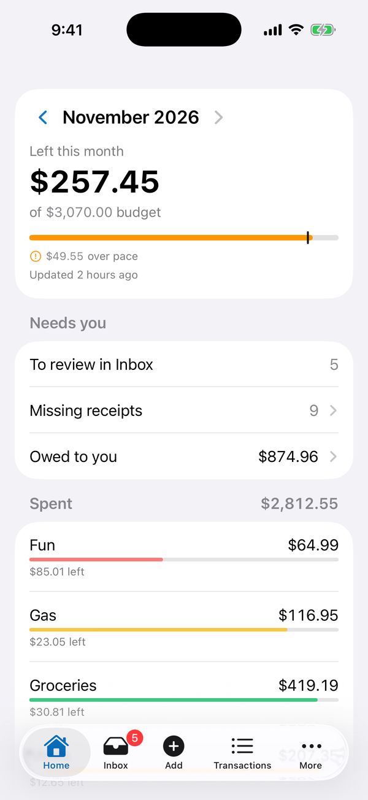
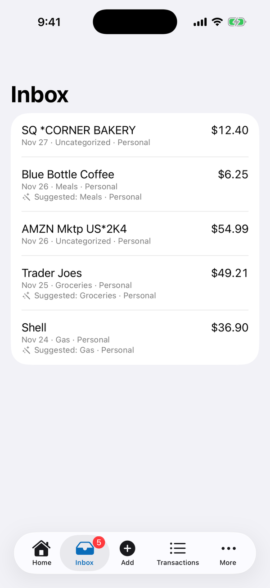
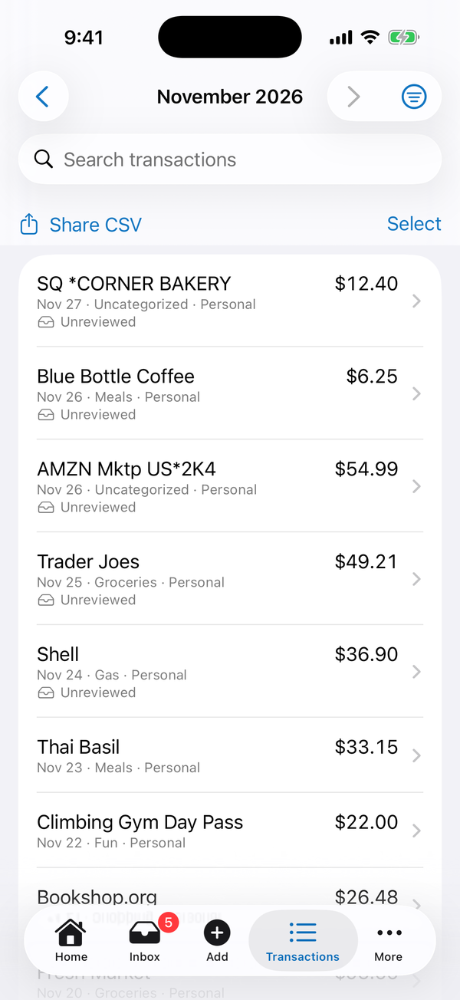
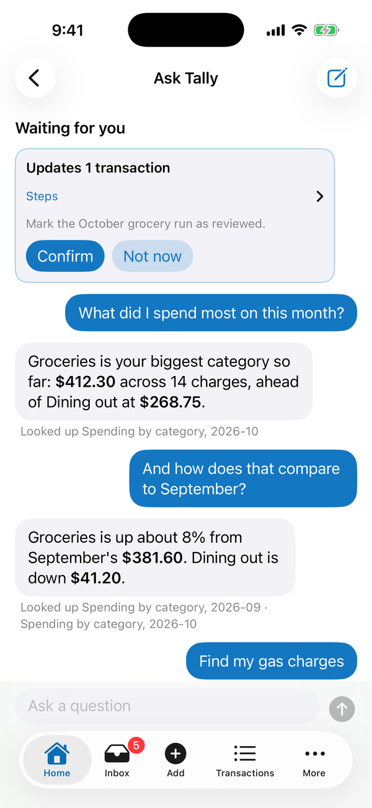

# Tally

A personal expense tracker: a SwiftUI iPhone app in front of a FastAPI + PostgreSQL server that pulls bank and card transactions every night through SimpleFIN Bridge.

I built it to replace a budgeting spreadsheet, and ran it for myself in production on a single Google Cloud VM. The hosted instance is now shut down; the whole thing runs locally with fake data (see [Run it locally](#run-it-locally)).

<p>
  
  
  
  
</p>

Screenshots show fake data.

## What it does

- **Bank sync.** A worker pulls new transactions from SimpleFIN Bridge every night, matches them against anything entered by hand, and flags a bank whose data has gone stale.
- **Inbox.** New charges land in an inbox to confirm. Rules and past choices suggest the category, and a push notification says when there is something to review.
- **Budgets and Home.** One screen answers "how much is left this month", with spending against each category budget, bills coming due and money owed back.
- **Manual capture.** A keypad for cash and not-yet-posted charges, with receipt photos. Captures are queued on the phone and sent with a phone-generated ID, so a retry never creates a duplicate.
- **Cards and payoff.** Card and loan balances, interest, and a payoff plan that honours promotional rates.
- **Work and tax.** Personal, business and reimbursable buckets, splits, reimbursement tracking, a mileage log with IRS rates, and a year-end tax summary and export.
- **Import and export.** CSV import from bank exports with column mapping, and CSV export of any month.
- **Assistant.** Claude answers questions about spending by calling read-only tools over the user's own data, reads receipts, drafts a weekly review, and proposes changes that only apply after a tap on Confirm. It runs server-side under a monthly spending cap.

## How it's built

```
iPhone app (SwiftUI)  --HTTPS-->  Caddy  -->  FastAPI  -->  PostgreSQL
                                              worker (APScheduler): nightly sync, backup, AI jobs
                                                 |--> SimpleFIN Bridge, APNs, Claude API
```

| Part | Stack |
|---|---|
| iOS app (`ios/`) | Swift 6, SwiftUI, Observation, URLSession with async/await, iOS 17+. No third-party packages. Tests in Swift Testing. |
| API (`api/`) | Python 3.14, FastAPI, SQLAlchemy 2, Alembic, Pydantic settings, pytest. Managed with uv; linted with ruff, type-checked with pyright. |
| Worker | APScheduler in its own container: bank sync, encrypted backup, weekly review, receipt reading. |
| Deployment | Docker Compose (Caddy, Postgres, API, worker) on one VM. See [docs/deployment.md](docs/deployment.md). |
| CI | GitHub Actions: lint, types, tests against a Postgres service, dependency audit and a Docker build. |

Some decisions worth a look:

- **Passkeys only.** There is no password. Sign-in is WebAuthn, with short-lived access tokens, rotating refresh tokens (reuse is detected and alerts), rate limits, a sign-in activity log, and App Attest: the app signs its sign-in and refresh requests, and a server setting (off by default) refuses any request without a valid assertion. Code in `api/app/auth/`.
- **No financial data on the phone.** Screens load live from the API. Only Keychain tokens and the outbox of unsent captures persist, and the app sits behind Face ID.
- **Secrets never touch the VM's disk.** A systemd unit fetches them from Secret Manager into tmpfs before Docker starts, and settings refuse placeholder secrets when `ENVIRONMENT=production`. The stored SimpleFIN access is encrypted at rest.
- **Keyless Claude access.** In production the server traded the VM's Google identity token for a short-lived Claude token (Workload Identity Federation), so there was no API key to store or rotate.
- **Migrations are checked.** A test fails if a model changes without a matching Alembic migration.
- **Monitoring as a script.** `deploy/monitoring/apply.py` idempotently creates the log metrics, uptime check and alert policies.

## How it was built

Tally started as a budgeting spreadsheet I had outgrown. I wrote a build spec for the app I wanted and split it into eleven milestones and about a hundred issues. The decisions were mine: passkeys instead of passwords, no financial data on the phone, and an assistant that can't change anything until I tap Confirm. So were the rules for reimbursements and the tax buckets. I set up the production instance on Google Cloud and ran it against my own accounts, using the app every day. What I found there became fixes and new features.

I worked with Claude Code throughout. It wrote much of the code and ran review passes on pull requests, following conventions I set in `CLAUDE.md` and `.claude/rules/`. I reviewed what went in and tested it on my own phone, and nothing shipped unless I decided it should.

This repository starts from a single commit. I developed Tally in a private repository (about 500 commits and 135 pull requests). Its issue threads and commit metadata mention my own bank accounts and a personal email address, so I published a fresh copy and left that history private. No secrets were ever committed, and that is not why the history is missing: gitleaks runs on every commit, and a scan of the full private history finds no credentials. Issue numbers in code comments (such as `#23`) refer to the private tracker.

## Repository layout

```
api/                 FastAPI app, worker, Alembic migrations, scripts, tests (uv project)
ios/                 SwiftUI app and tests
deploy/              Secret-fetching systemd unit and the monitoring script
docs/                Deployment notes and screenshots
docker-compose.yml   Caddy, Postgres, API, worker (production shape)
compose.dev.yml      Local only: publishes Postgres on 127.0.0.1:5433
Caddyfile            HTTPS front door
```

```
api/app/
  main.py         create_app() factory; lifespan owns the DB engine
  config.py       Settings; refuses placeholder secrets when ENVIRONMENT=production
  db.py           Engine/session factory, get_db dependency
  deps.py         CurrentUser, AppSettings, DB dependencies
  errors.py       AppError/NotFound/Unauthorized/Conflict and the one error shape
  log.py          Loguru setup; stdlib logging (uvicorn, SQLAlchemy) routed into it
  middleware.py   Request ID, access log line, unhandled-error 500s
  auth/           Tokens, passkeys, App Attest, rate limits, auth events
  models/         SQLAlchemy tables (constraint naming convention in base.py)
  schemas/        Pydantic request/response models
  routers/        One file per resource; everything under /api except /api/auth needs a token
  services/       SimpleFIN, matching, rules, APNs, exports, the assistant
  worker.py       APScheduler jobs
```

Errors always look like `{"error": {"code", "message", "request_id", "details"?}}`, and every response carries `X-Request-ID`.

## Run it locally

You need Docker, [uv](https://docs.astral.sh/uv/) and, for the app, Xcode.

```sh
cp .env.example .env
docker compose -f docker-compose.yml -f compose.dev.yml up -d db

cd api
uv sync
uv run alembic upgrade head
uv run python -m scripts.seed_fake_data
uv run uvicorn --factory app.main:create_app --reload     # leave running; docs at http://127.0.0.1:8000/docs

# in a second terminal, from api/
uv run python -m scripts.dev_token                        # prints a token and http://127.0.0.1:8000/dev/#token=...
```

Open the printed URL for a throwaway web page that clicks through the API with the fake data, no passkey needed. It is only mounted when `ENVIRONMENT=development`, and the token script refuses to run in production. The token lasts 8 hours (`--minutes` changes it).

Use `127.0.0.1` rather than `localhost` for Postgres and the server URL; `localhost` can try IPv6 first and stall.

### iOS app

Open `ios/Tally.xcodeproj` in Xcode and run the `Tally` scheme on a simulator, with the API running as above. On the sign-in screen, tap "Developer" and paste the token from `scripts.dev_token`. Or launch already signed in:

```sh
SIMCTL_CHILD_TALLY_DEV_TOKEN=<token> xcrun simctl launch booted com.luisd07.tally
```

Dev sign-in and plain HTTP are DEBUG only. Passkey sign-in needs a real server on a real domain. The repo ships placeholders: the app's domain is `api.example.com` in `Session.productionServerURL` and in its associated domains (`ios/Config/Tally.entitlements`), and no Apple Team ID is set. Simulator builds work as they are. To run your own, change the domain in both places, pick your team under Signing & Capabilities in Xcode, and set `API_DOMAIN`, `WEBAUTHN_RP_ID`, `WEBAUTHN_ORIGIN` and `APNS_TEAM_ID` in the server's `.env` (the `Caddyfile` reads the domain and Team ID from there).

The assistant is off unless `ANTHROPIC_API_KEY` (or the federation settings) is set; everything else works without it.

## Checks

```sh
cd api
uv run ruff check . && uv run ruff format --check .
uv run pyright
uv run pytest            # needs the dev Postgres; creates and migrates tally_test
uv run pip-audit
```

```sh
xcodebuild -project ios/Tally.xcodeproj -scheme Tally -destination 'platform=iOS Simulator,name=iPhone 17 Pro' test
```

`uvx pre-commit install` runs gitleaks, ruff, pyright and the lockfile check on every commit.

## Migrations

```sh
cd api
uv run alembic revision --autogenerate -m "add accounts"
uv run alembic upgrade head
```

## Licence

[MIT](LICENSE)
